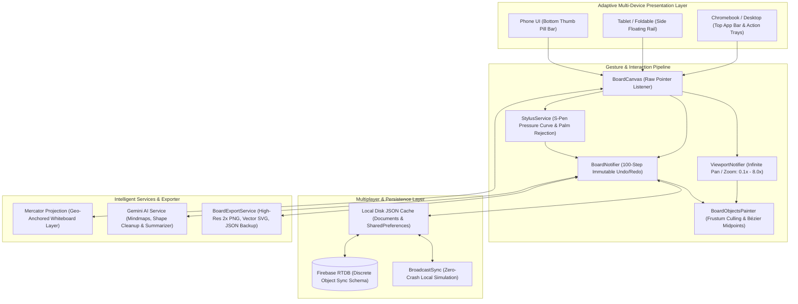
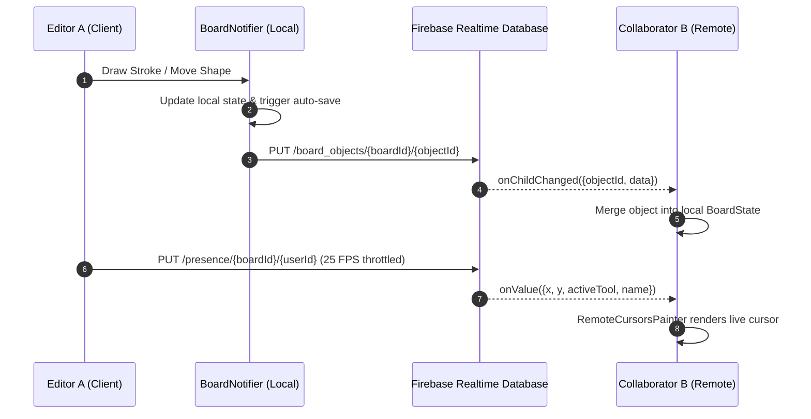
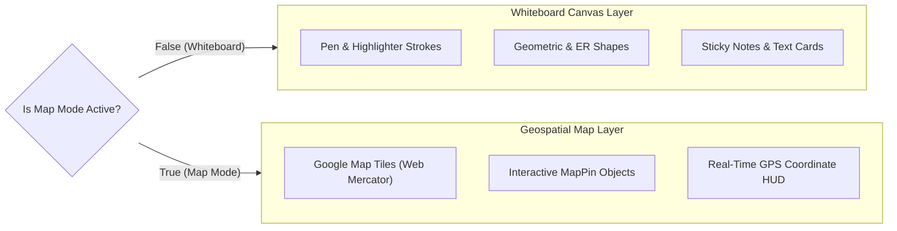
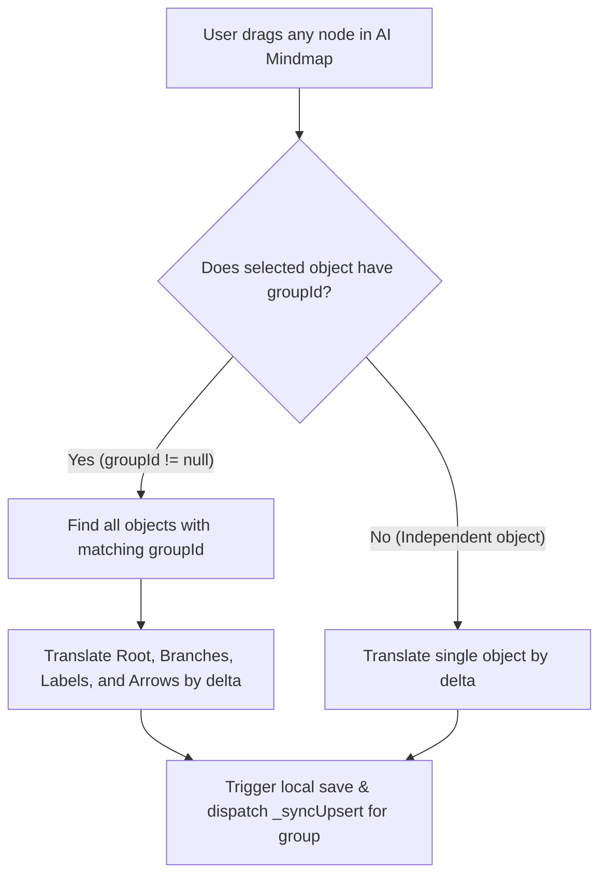

# 🎨 SyncBoard AI

> **A collaborative, intelligent whiteboard application engineered for the Android ecosystem (Phones, Foldables, Tablets & Chromebooks), Windows Desktop, and Web with Miro-grade smoothness, real-time multiplayer sync, geospatial maps, multimodal Gemini AI, S-Pen stylus support, and multi-format vector/raster export.**

[](https://flutter.dev)
[](https://dart.dev)
[](https://flutter.dev/multi-platform)
[](https://riverpod.dev)
[]()
[]()
[](https://opensource.org/licenses/MIT)
[](https://github.com/ShwetankSharma10/whiteboard-ai/pulls)

---

## 📑 Table of Contents
- [Overview & Highlights](#-overview--highlights)
- [Architecture & System Flow](#-architecture--system-flow)
- [Key Features](#-key-features)
  - [Infinite Canvas & Gesture Pipeline](#1-infinite-canvas--gesture-pipeline)
  - [Real-Time Multiplayer Sync & Presence](#2-real-time-multiplayer-sync--presence)
  - [Multimodal Gemini AI Engine](#3-multimodal-gemini-ai-engine)
  - [Geospatial Map Mode & Layer Segregation](#4-geospatial-map-mode--layer-segregation)
  - [Engineering Diagrams & Database ER Modeling](#5-engineering-diagrams--database-er-modeling)
  - [Samsung S-Pen & Stylus Pipeline](#6-samsung-s-pen--stylus-pipeline)
  - [Multi-Format Exporter & Sharing](#7-multi-format-exporter--sharing)
- [System Design Diagrams](#-system-design-diagrams)
- [Getting Started & Setup Guide](#-getting-started--setup-guide)
  - [Prerequisites](#prerequisites)
  - [1. Clone & Install Dependencies](#1-clone--install-dependencies)
  - [2. Zero-Config Local Mode (Runs Instantly)](#2-zero-config-local-mode-runs-instantly)
  - [3. Optional: Configure Firebase Cloud Sync](#3-optional-configure-firebase-cloud-sync)
  - [4. Optional: Configure Gemini AI Key](#4-optional-configure-gemini-ai-key)
- [Running & Building](#-running--building)
  - [Run on Android Emulator / Physical Device](#run-on-android-emulator--physical-device)
  - [Run in Google Chrome (Web)](#run-in-google-chrome-web)
  - [Run on Windows Desktop](#run-on-windows-desktop)
  - [Building Release APK & Web](#building-release-apk--web)
- [Automated Testing Suite](#-automated-testing-suite)
- [Project Directory Structure](#-project-directory-structure)
- [Security Notice](#-security-notice)
- [Contributing](#-contributing)
- [License](#-license)

---

## 🌟 Overview & Highlights

**SyncBoard AI** is designed to deliver a modern visual workspace with real-time multiplayer capability, offline-first reliability, hardware-accelerated drawing, and AI assistance:

1. **Miro-Grade Smoothness**: Zero gesture-arena lag, 120 FPS sub-pixel stroke interpolation, quadratic Bézier midpoint smoothing, infinite dot grid, and 100-step immutable undo/redo history.
2. **Offline-First Zero-Crash Architecture**: Boots instantly out-of-the-box in local mode with disk caching, automatic fallback broadcast sync, and no required external dependencies for local development.
3. **Discrete Object Cloud Synchronization**: Powered by Firebase Realtime Database with flattened object paths to eliminate document overwrite race conditions.
4. **Multimodal Gemini AI Engine**: Prompt-to-mindmap generation with cohesive diagram tree movement, rough sketch recognition to clean geometry, and board summarization.
5. **Dual-Mode Geospatial Mapping**: Seamlessly toggle between Miro dot grid and real Web Mercator Google Map tiles, with full visual segregation preventing whiteboard sketches from cluttering the world map.
6. **Hardware Stylus Precision**: First-class Samsung S-Pen support with non-linear pressure thickness curves, inverted tail erasing, and hardware palm rejection.

---

## 📌 Architecture & System Flow



---

## ✨ Key Features

### 1. Infinite Canvas & Gesture Pipeline
- **Raw Pointer Dispatch**: Multi-touch handling via Flutter's `Listener` bypassing standard gesture arena deadlocks.
- **Gesture Disambiguation**: Single pointer draws or manipulates; two or more pointers trigger smooth pinch-to-zoom (0.1x to 8.0x) and pan while safely cancelling in-flight strokes.
- **Adaptive Frustum Culling**: Canvas only paints visible objects intersecting the active viewport boundaries, keeping rendering frame times under 8ms even with thousands of strokes.
- **Infinite Dot Grid**: High-performance grid painter with dynamic density reduction at low zoom levels to eliminate rendering bottlenecks.
- **Atomic Undo/Redo**: 100-step immutable history buffer where continuous eraser sweeps and multi-object drags count as a single atomic undo step.

### 2. Real-Time Multiplayer Sync & Presence
- **Granular Discrete Object Sync**: Flat `/board_objects/{boardId}/{objectId}` architecture where each card, stroke, or shape updates independently—preventing monolithic state overwrite conflicts.
- **Live Remote Cursors**: 25 FPS throttled cursor broadcasts with collaborator name badges and custom user avatar colors.
- **Zero-Crash Fallback**: Automatically switches to an in-memory broadcast sync engine when Firebase credentials are not provisioned, allowing full local testing and simulation without cloud accounts.
- **Simulate Collaborator**: In-app simulator that spawns an active collaborator moving their cursor and interacting with notes for immediate demo testing.

### 3. Multimodal Gemini AI Engine
- **Prompt-to-Mindmap Generation**: Transforms natural language concepts (e.g., *"Cloud Microservices Architecture"*) into structured diagram trees with root, branches, and leaf nodes.
- **Cohesive Group Movement**: Every generated mindmap is bound by a shared `groupId`. Dragging any node, branch label, or arrow smoothly translates the entire connected mindmap tree as one unit.
- **Automatic Tool Handoff**: Upon generation, the canvas automatically transitions to `BoardTool.select` and selects the root node so users can immediately move, scale, or inspect the diagram without accidental pen marks.
- **Rough Sketch Recognition**: On-device geometric shape recognizer converts wobbly hand-drawn strokes into clean vector arrows, circles, and rectangles.
- **Board Content Summarizer**: Scans active board text and notes, generating structured action items and strategic summaries into sticky note cards.

### 4. Geospatial Map Mode & Layer Segregation
- **Web Mercator (EPSG:3857) Math**: Mathematical projection converting geographic coordinates (`latitude`, `longitude`) to infinite whiteboard scene coordinates and vice versa.
- **Dual-Mode Visual Isolation**: Whiteboard drawings remain on the whiteboard; switching to Map Mode reveals real Google Map tiles and GPS pins without cluttering the map with whiteboard drawings.
- **Geodesic Pin Distance Tool**: Computes exact Haversine distances between pins in kilometers, miles, and flight time estimates.
- **Interactive GPS HUD**: Floating coordinates widget displaying active cursor latitude/longitude and nearest landmark or capital city.

### 5. Engineering Diagrams & Database ER Modeling
- **11 Vector Geometric Shapes**: Triangle, Diamond (Decision), Star (Milestone), Hexagon (Service), Parallelogram (Data/IO), Cylinder (Database/Storage), Cloud (Gateway), Rectangle, Circle, Line, and Arrow.
- **Database ER Tables (`ErTableObject`)**: Entity cards featuring table headers, column lists, Primary Key `[PK]` badges, Foreign Key `[FK]` badges, and monospace data types.
- **Crow's Foot Relationship Connectors**: Connectors supporting `1:1`, `1:N`, and `N:M` cardinality with interactive anchor points and relationship labels.
- **One-Click Engineering Templates**: Built-in architecture templates including E-Commerce Schema (4 tables), RBAC Auth & Roles Schema, and Microservices Flow.

### 6. Samsung S-Pen & Stylus Pipeline
- **Hardware Stylus Tip Detection**: Differentiates between finger touches, capacitive styluses, and active digitizer styluses (`PointerDeviceKind.stylus` / `invertedStylus`).
- **Dynamic Pressure Curves**: Non-linear pressure-to-thickness curve scaling stroke thickness smoothly with physical stylus pressure.
- **Inverted Tail Eraser**: Flipping a supported stylus to use the physical tail automatically triggers the precision eraser tool without touching toolbar buttons.
- **Hardware Palm Rejection**: Rejects large touch contact patches (> 25px radius) and suppresses single-finger touch triggers within 400ms of active stylus input.

### 7. Multi-Format Exporter & Sharing
- **2x Retina PNG Rasterization**: High-resolution image export with interactive in-app preview dialog and automatic saving to the device's public Downloads directory.
- **Standalone SVG Vector Markup**: Generates standard XML SVG vector files with viewBox calculation, styling, and text preservation for Figma/Illustrator.
- **Full JSON Board Backup**: Serializes complete board state for offline archiving and cross-instance import.
- **Collaborative Deep-Links**: Generates direct access links for collaborators (Read-Write Editor or View-Only Guest mode).

---

## 📊 System Design Diagrams

### 1. Discrete Object Sync Flow


### 2. Dual-Layer Geospatial Mapping & Isolation Flow


### 3. Cohesive Mindmap Group Movement Engine


---

## 🚀 Getting Started & Setup Guide

### Prerequisites
- **Flutter SDK**: `^3.24.0` (Recommended `3.27.x` or later)
- **Dart SDK**: `^3.5.0`
- **Android Studio** / VS Code with Flutter and Dart extensions
- **Android SDK** (API Level 24+ for Android 7.0 Nougat and above)
- **Git**

---

### 1. Clone & Install Dependencies

```bash
# Clone the repository
git clone https://github.com/ShwetankSharma10/whiteboard-ai.git
cd whiteboard-ai

# Fetch dependencies
flutter pub get
```

---

### 2. Zero-Config Local Mode (Runs Instantly)

SyncBoard AI is designed to run **immediately without configuring external cloud services**:
- No Firebase setup required to try the app.
- Automatically falls back to local disk storage (`SharedPreferences` & local JSON) and an in-memory broadcast sync engine.
- AI features fall back to offline templates if Gemini API keys are not provided.

Simply run:
```bash
flutter run
```

---

### 3. Optional: Configure Firebase Cloud Sync

To enable multi-user real-time cloud synchronization with your own Firebase project:

#### Option A: Using FlutterFire CLI (Automated)
```bash
# Install FlutterFire CLI if not already installed
dart pub global activate flutterfire_cli

# Configure Firebase for Android, Web, and Windows
flutterfire configure --project=your-firebase-project-id
```

#### Option B: Manual Configuration
1. Create a Firebase project at the [Firebase Console](https://console.firebase.google.com/).
2. Enable **Realtime Database** and **Firebase Authentication** (Anonymous or Email/Password).
3. Copy the template configuration files:
   ```bash
   cp lib/firebase_options.dart.example lib/firebase_options.dart
   cp android/app/google-services.json.example android/app/google-services.json
   ```
4. Replace the placeholder values (`YOUR_ANDROID_API_KEY`, `your-project-id`, database URL) with your project credentials.

---

### 4. Optional: Configure Gemini AI Key

To enable live Google Gemini Multimodal AI generation:
1. Obtain an API key from [Google AI Studio](https://aistudio.google.com/).
2. Pass the key at build/run time using `--dart-define`:

```bash
flutter run --dart-define=GEMINI_API_KEY=your_gemini_api_key_here
```

In **Android Studio**:
1. Go to **Run > Edit Configurations...**
2. In **Additional run args**, enter:
   ```
   --dart-define=GEMINI_API_KEY=your_gemini_api_key_here
   ```
3. Click **Apply** and run.

---

## 📱 Running & Building

### Run on Android Emulator / Physical Device
```bash
# List available devices/emulators
flutter devices

# Launch on connected Android device
flutter run -d android
```

### Run in Google Chrome (Web)
```bash
flutter run -d chrome
```

### Run on Windows Desktop
```bash
flutter run -d windows
```

### Building Release APK & Web
```bash
# Build standalone release APK
flutter build apk --release

# Build Google Play App Bundle (AAB)
flutter build appbundle --release

# Build optimized Web release
flutter build web --release
```
The output APK will be located at:
`build/app/outputs/flutter-apk/app-release.apk`

---

## 🧪 Automated Testing Suite

SyncBoard AI maintains a **100% test pass rate across 77 comprehensive automated test cases**:

```bash
# Run all unit and integration tests
flutter test

# Run static code analysis (zero warnings guarantee)
flutter analyze
```

### Test Coverage Highlights:
| Test Suite | Tests | Key Validations |
| :--- | :---: | :--- |
| `test/board_map_test.dart` | **11** | Mercator projection math, Haversine distances, map pin serialization, **dual-mode layer segregation** |
| `test/board_ai_test.dart` | **8** | Prompt-to-mindmap, rough sketch recognition, board summarizer, **cohesive mindmap group movement** |
| `test/board_sync_test.dart` | **12** | Real-time presence models, broadcast sync engine, cross-board isolation, remote user filtering |
| `test/board_notifier_test.dart` | **13** | Drawing primitives, 100-step undo/redo, atomic erasing, spatial hit-testing |
| `test/board_export_test.dart` | **10** | High-res PNG raster bytes, vector SVG syntax, JSON backup schema, collaborative share links |
| `test/board_shapes_er_test.dart` | **7** | 11 geometric shapes, ER database tables with PK/FK badges, crow's foot connectors, 60+ location presets |
| `test/board_stylus_test.dart` | **6** | Stylus tip classification, inverted tail eraser, 400ms palm rejection, pressure thickness curves |
| `test/board_security_test.dart` | **3** | App Check safe fallback, ProGuard R8 keep rules validation, GitHub Actions CI workflow checks |
| **Total** | **77** | **100% Passing** |

---

## 📂 Project Directory Structure

```
lib/
├── app/
│   ├── router.dart             # go_router configuration with reactive Auth Guard
│   └── theme.dart              # Material 3 light & dark theme design tokens
├── features/
│   ├── auth/
│   │   ├── data/repositories/  # AuthRepository & local session store
│   │   ├── domain/models/      # Immutable UserModel (Freezed)
│   │   └── presentation/       # LoginScreen & Riverpod auth providers
│   ├── board/
│   │   ├── data/
│   │   │   ├── app_check_service.dart      # Firebase App Check & Play Integrity attestation
│   │   │   ├── board_export_service.dart   # High-Res 2x PNG, Vector SVG, JSON & Share Links
│   │   │   ├── board_storage_service.dart  # Local device JSON & SharedPreferences persistence
│   │   │   ├── board_sync_repository.dart  # Dual-mode Firebase RTDB & Broadcast sync
│   │   │   ├── gemini_ai_service.dart      # Multimodal Gemini AI (Mindmaps, Shapes, Summarizer)
│   │   │   └── stylus_service.dart         # S-Pen pressure curve & hardware palm rejection
│   │   ├── domain/models/
│   │   │   ├── board_object.dart           # Sealed object hierarchy with isMapObject & groupId
│   │   │   ├── map_projection.dart         # Web Mercator math & 60+ global presets
│   │   │   └── presence.dart               # Collaborator presence & cursor models
│   │   └── presentation/
│   │       ├── board_screen.dart           # Primary whiteboard viewport screen
│   │       ├── providers/                  # BoardNotifier, ViewportNotifier, SyncProvider
│   │       └── widgets/                    # BoardCanvas, BoardToolbar, Custom Painters
│   └── dashboard/
│       └── presentation/       # DashboardScreen & board gallery overview
├── ui/
│   └── layouts/                # AdaptiveLayout (Handheld Phone, Foldable/Tablet, Desktop)
├── firebase_options.dart       # Firebase configuration template (Sanitized)
└── main.dart                   # Application entrypoint with offline fallback detection

.github/
└── workflows/
    └── ci.yml                  # GitHub Actions CI/CD (Format, Analyze, Test, Build Web & APK)

android/app/
├── google-services.json        # Android Firebase services configuration (Sanitized template)
└── proguard-rules.pro          # ProGuard & R8 release rules (Play Core & Flutter engine)

test/
├── board_ai_test.dart          # Gemini AI mindmaps, group movement, and summarizer tests
├── board_export_test.dart      # PNG, SVG, JSON, and share link tests
├── board_map_test.dart         # Map projection, geospatial pins, and layer segregation tests
├── board_notifier_test.dart    # Canvas objects, undo/redo, and viewport tests
├── board_security_test.dart    # App Check, ProGuard, and CI workflow tests
├── board_shapes_er_test.dart   # Shapes, ER tables, crow's foot relationships, and presets tests
├── board_stylus_test.dart      # S-Pen stylus, palm rejection, and pressure curve tests
└── board_sync_test.dart        # Real-time multiplayer sync and presence tests
```

---

## 🔒 Security Notice

- **Public Repository Ready**: All Firebase configurations, API keys, database URLs, and client IDs in this repository have been strictly replaced with sanitized template placeholders (`YOUR_API_KEY`, `your-project-id`).
- **No Hardcoded Secrets**: Secrets such as `GEMINI_API_KEY` and `GOOGLE_MAPS_API_KEY` are read exclusively at compile/run time via `--dart-define` and are never committed to version control.
- **Git Hygiene**: `.gitignore` is configured to exclude all private environment files (`.env*`), Android signing keystores (`*.keystore`, `*.jks`, `key.properties`), local device SDK configurations (`local.properties`), binary release artifacts (`*.apk`, `*.aab`), and temporary files.

> [!TIP]
> If you previously tested with personal Firebase or Google Cloud credentials on a private branch, ensure your production keys are restricted by HTTP referrer / Android package SHA-256 fingerprint in the [Google Cloud Console](https://console.cloud.google.com/apis/credentials).

---

## 🤝 Contributing

Contributions, issues, and feature requests are welcome!

1. Fork the Project.
2. Create your Feature Branch:
   ```bash
   git checkout -b feat/amazing-feature
   ```
3. Ensure formatting and tests pass:
   ```bash
   dart format lib test
   flutter analyze
   flutter test
   ```
4. Commit your Changes:
   ```bash
   git commit -m "feat: Add amazing feature"
   ```
5. Push to the Branch:
   ```bash
   git push origin feat/amazing-feature
   ```
6. Open a Pull Request.

---

## 📄 License

This project is licensed under the **MIT License** - see the [LICENSE](LICENSE) file for details.
